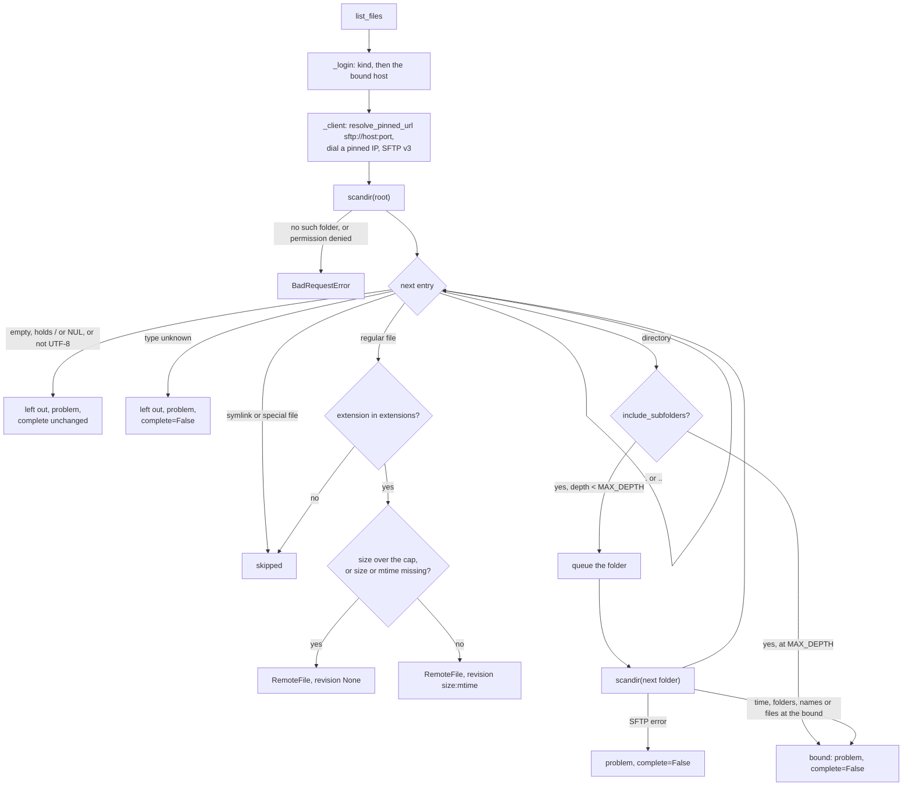
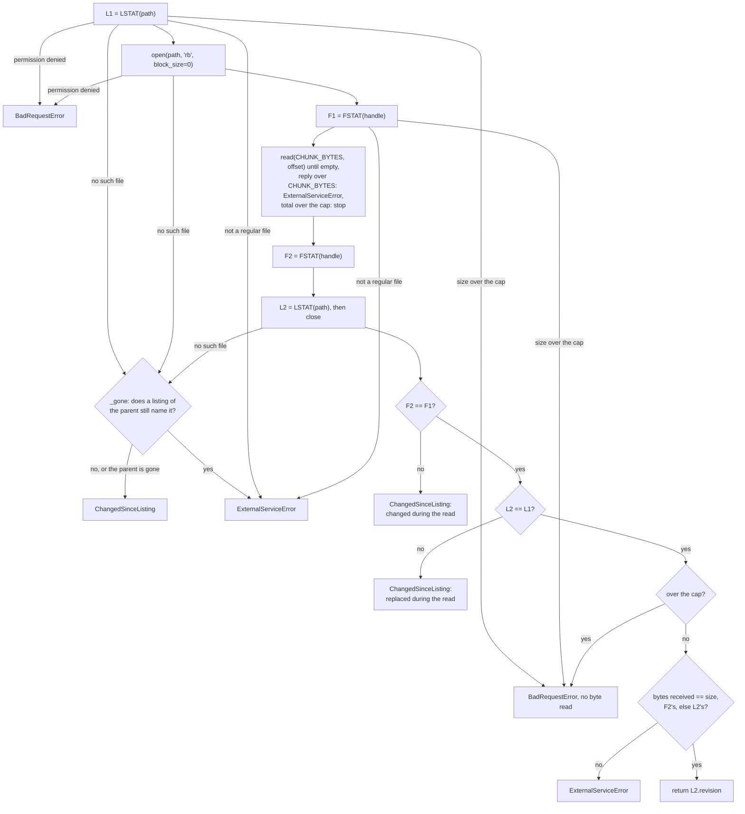

# Design: an SFTP sync connector (#29)

Base: `feat/sync-file-revision` at `2763c7e8c` (fork PR #30, the revision seam of #28).
Line numbers are on that commit. The research reports are in the session scratchpad:

- `research-asyncssh.md`: asyncssh 2.24.1 defaults, `known_hosts` form, exceptions,
  SFTP attributes, read hazards, the in-process server, proof output.
- `research-servers.md`: OpenSSH (atmoz, linuxserver), SFTPGo, ProFTPD `mod_sftp` and
  Apache MINA SSHD, run live with asyncssh 2.24.1.
- `research-licence.md`: asyncssh against paramiko under `scripts/license_inventory.py`.

A citation such as "(asyncssh §5)" names the report and its section.

## Summary

A new connector, `sftp`, reads a folder tree from an SFTP server into a collection. It
uses asyncssh 2.24.1 or later, directly. A new vault secret kind, `ssh_credentials`,
holds a user name with a private key or a password, and the one host and port the
secret may be used with. The source config holds the server's public host key. The
connector reports `size:mtime` as the revision of each file, so `new_only` and
`update_only` skip the download of an unchanged file (#28). `_fetch` returns the
revision of the bytes it wrote, and raises `ChangedSinceListing` only on evidence from
the server.

No migration and no API route change. One deployment setting is new:
`SYNC_ALLOWED_HOSTS`, empty by default, lets an operator list SFTP servers on the
company network. The maintainer decided the two open questions: asyncssh is the library
([Decision: the licence](#decision-the-licence)), and private servers are reachable
through that allowlist ([Decision: servers on a private network](#decision-servers-on-a-private-network)).

## Requirements map

| Requirement (`requirements.md`) | Where this design answers it |
|---|---|
| asyncssh >= 2.24.1, used directly | `backend/pyproject.toml` under [Modules and changes](#modules-and-changes), [Connection](#connection-and-hardening) |
| `config=None`, `agent_path=None`, explicit keys and known hosts, pinned host key | [Connection](#connection-and-hardening) |
| No `get(recurse=True)`, no `mget` | [`_fetch`](#_fetch-the-evidence-chain): no `get()` of any kind |
| `sftp://host:port` with the port explicit, the web connector's SSRF guard | [Address and SSRF](#address-and-ssrf). The guard stays. Only a host the operator lists in `SYNC_ALLOWED_HOSTS` may resolve to a private address ([decision](#decision-servers-on-a-private-network)) |
| Revision is size + mtime, the docstring names the gap, `full` is the remedy | [Listing](#listing), [Known limits](#known-limits) |
| `source_path` names the server | [Address and SSRF](#address-and-ssrf) |
| `fetch_file` is the only entry point | `SftpConnector` overrides `_fetch` only. The guard test covers it |
| `_fetch` returns the revision of the bytes it wrote | [`_fetch`](#_fetch-the-evidence-chain) |
| `ChangedSinceListing` only on evidence, a "no such file" needs a listing | [`_fetch`](#_fetch-the-evidence-chain), `_gone` |
| Remote names untrusted: links, loops, depth, count, size, in the listing too | [Listing](#listing), [Bounds](#bounds-and-timeouts) |
| Licence: present both, recommend one | [Decision: the licence](#decision-the-licence): asyncssh, decided |
| Unit tests, an in-process server test, real-server runs, mutation checks | [Test strategy](#test-strategy) |
| Docs in four languages, a CHANGELOG entry | [Documentation](#documentation) |

## Modules and changes

### New: `backend/app/services/rag/connectors/sftp.py`

The connector, its config model, and the module constants. The module docstring states:
the credential and its host binding, the address, the change signal and the edit it
can miss, the hardening, the bounds, the residual race of the read, and the
`getpass` note. asyncssh is imported inside the functions that use it, never at module
level (`tests/test_import_cost.py`, upstream `#2225`). Types come from a
`TYPE_CHECKING` block.

#### Constants

| Name | Value | What it bounds |
|---|---|---|
| `CONNECT_SECONDS` | 30.0 | `connect_timeout` and `login_timeout` (TCP, banner, key exchange and login together, asyncssh §5 table) |
| `KEEPALIVE_SECONDS` | 30.0 | `keepalive_interval`. `keepalive_count_max` is 3 |
| `REQUEST_SECONDS` | 30.0 | One SFTP request. asyncssh has no deadline of its own (asyncssh §5, "No per-request timeout") |
| `LISTING_SECONDS` | 1800.0 | The whole listing |
| `FILE_SECONDS` | 600.0 | One file's download (50 MB at about 85 KB/s) |
| `CHUNK_BYTES` | 261120 (255 KiB) | One read request. OpenSSH caps a read at this size (asyncssh §5) |
| `MAX_DEPTH` | 32 | Folder levels below the root |
| `MAX_FOLDERS` | 10_000 | Folders opened in one listing |
| `MAX_NAMES` | 1_000_000 | Directory entries read in one listing, of every type |
| `MAX_FILES` | 100_000 | Files in one listing |
| `_REGULAR`, `_DIRECTORY`, `_SYMLINK`, `_UNKNOWN` | 1, 2, 3, 5 | SFTP file types (asyncssh `constants.py:210-220`). Local, so the module does not import asyncssh. A unit test pins them to asyncssh's values |
| `_HOST_KEY_TYPES` | `ssh-ed25519`, `ssh-ed448`, `ecdsa-sha2-nistp256`, `ecdsa-sha2-nistp384`, `ecdsa-sha2-nistp521`, `ssh-rsa` | The host key types the config accepts |

The file cap is the deployment's `MAX_UPLOAD_SIZE_MB` (`app/core/config.py:51`, 50 by
default), read at call time, as SharePoint does (`sharepoint.py:721`) and Git does
(`git.py:465`). No bound is a config field. The maintainer wants low maintenance, and
each bound is a guard against a hostile or broken server, not a choice an editor makes.

#### `SftpConfig(BaseModel)`

| Field | Type | Default | Contract |
|---|---|---|---|
| `host` | `str` | required | A host name or an IP literal. Stripped and lower-cased. A bracketed IPv6 literal loses its brackets. A name is IDNA-encoded with `encode("idna")`, as `GitConfig` does (`git.py:164-179`). Refused: a scheme, a path, `@`, a port (`host:2222` gets "Put the port in the Port field"), an IPv6 zone (`%`), whitespace, an empty label, over 253 characters |
| `port` | `int` | 22 | `ge=1, le=65535`. Port 0 must be refused here: `_checked_target` reads `parsed.port or default_port`, so `sftp://h:0` becomes port 80 (`sanitize.py:246-248`) |
| `root_path` | `str` | required | An absolute folder path on the server. Normalized with `PurePosixPath` (`//` and `/./` collapse). Refused: a relative path, a `..` segment, NUL or another control character, over 1024 characters. Required, not `/` by default: on a server that does not lock the account in its home folder, `/` is the whole file system |
| `host_key` | `str` | required | One OpenSSH public key line, `<type> <base64> [comment]`. `json_schema_extra={"x-textarea": True}`, because an RSA key is about 550 characters. The type must be in `_HOST_KEY_TYPES`. A `known_hosts` line (`host ssh-ed25519 ...`, which `ssh-keyscan` prints) is refused with a sentence that says to drop the host field. A PEM block is refused before asyncssh sees it, because `import_public_key` accepts a private key and returns its public half (asyncssh §2). Then `asyncssh.import_public_key(line)` must succeed, and its `algorithm` must equal the line's type. The validator returns `<type> <base64>` without the comment |
| `include_subfolders` | `bool` | `True` | As `SharePointConfig.include_subfolders` |
| `extensions` | `list[str]` | `DEFAULT_EXTENSIONS` | The file types to read, with SharePoint's rule (`sharepoint.py:198-213`), now shared (see `connectors/__init__.py` below) |

Why `extensions` exists. S3 and Drive list every file, and SharePoint and Git filter by
type (`sharepoint.py:128-135`, `git.py:130-137`). A file that no parser reads fails at
parse (`documents.py:761`), so no document is stored for it, so no revision is stored.
The revision skip of #28 then never applies to it: the sync downloads it and counts it
as failed on every run, and the run is `error` for good. A partner drop or a scanner
folder holds such files (archives, spreadsheets). The two newest connectors filter by
type too, so a filter here follows them.

Methods:

- `url() -> str`: `sftp://<host>:<port>`, with an IPv6 host in brackets. The port is
  always present. This is the string `resolve_pinned_url` checks.
- `authority(username: str) -> str`: `sftp://<user>@<host>:<port>`. The user name is
  percent-encoded with `quote(username, safe="")`, so `@`, `/` and `:` in it cannot
  change where the host starts. An IPv6 host is in brackets.

#### `_Stat` (frozen dataclass)

`type: int`, `size: int | None`, `mtime: int | None`. `of(attrs: SFTPAttrs) -> _Stat`
reads the three fields. `revision` is `f"{size}:{mtime}"`, or `None` when either is
missing. `__eq__` is the dataclass's: all three fields. It keeps the comparisons in
`_fetch` explicit and lets a unit test check them without a server.

#### `SftpConnector(BaseSyncConnector)`

`CONNECTOR_TYPE = "sftp"`, `DISPLAY_NAME = "SFTP server"`,
`SECRET_KIND = SecretKind.SSH_CREDENTIALS`, `CONFIG_MODEL = SftpConfig`.

One instance serves one sync (`rag_tasks.py:1301` makes it). It holds the connection
between `list_files`, the downloads and `aclose`.

State: `_conn: SSHClientConnection | None`, `_sftp: SFTPClient | None`,
`_refusal: AppException | None` (the refusal of a failed connect, kept for the rest of
the sync), `_host: str` (for sentences).

Public contracts:

```python
async def validate_config(self, config: ConnectorConfig) -> ConfigRefusal | None
```

The required fields (base class), then `SftpConfig.model_validate`, with the first
error as `ConfigRefusal(message, field)` (`errors(include_url=False,
include_input=False)`, as SharePoint does, `sharepoint.py:594-612`). Then
`await asyncio.to_thread(resolve_pinned_url, parsed.url(), frozenset({"sftp"}),
trusted_hosts=_listed_hosts())`. A `UrlRefusedError` becomes
`ConfigRefusal(message=str(exc), field="host")`, as Git does (`git.py:255-278`). It sees
no credential, so the host binding waits for the sync.

```python
async def list_files(self, config: ConnectorConfig, credential: StorableSecret | None) -> RemoteListing
```

Validates the config, checks the credential (`_login`), opens the connection
(`_client`), and walks the tree (`_walk`). Raises `BadRequestError` for no credential,
a credential of another kind, a host the credential is not bound to, an SSRF refusal,
a refused login or host key, and a root folder that is missing or unreadable. Raises
`ExternalServiceError` for a server that cannot be reached, stops answering, or drops
the connection during the listing. A partial answer is `complete=False` with problems,
never an exception (see [Listing](#listing)).

```python
async def _fetch(self, file: RemoteFile, dest_path: Path, config: ConnectorConfig,
                 credential: StorableSecret | None) -> str | None
```

Writes the bytes of `file.id` (the absolute remote path) to `dest_path` and returns the
revision of those bytes: `size:mtime` from an `LSTAT` after the read, or `None` when
the server gives no size or mtime. Raises `ChangedSinceListing` only on evidence from
the server. Raises `BadRequestError` for a file over the cap and for a refused read,
and `ExternalServiceError` for a server that breaks the protocol or the evidence chain.
See [`_fetch`](#_fetch-the-evidence-chain).

```python
async def aclose(self) -> None
```

Closes the connection: `close()`, then `wait_closed()` under `REQUEST_SECONDS`, and
`abort()` when that expires. Safe twice, and before a connection exists.

`remote_version()` keeps the base default `None`. SFTP has no value for the whole
source (#29).

Private helpers, each one testable:

| Helper | Contract |
|---|---|
| `_login(credential, parsed) -> SshCredentialsSecret` | `None`: `BadRequestError` ("This SFTP source has no credential. Add an SSH login to the Vault and choose it as the source's credential."). Another kind: `BadRequestError`. `credential.allows(parsed.host, parsed.port)` false: `BadRequestError` naming both hosts, before anything is resolved or dialled, as Git does (`git.py:543-553`) |
| `_client(parsed, login) -> SFTPClient` | Re-raises `_refusal` when set, without dialling. Returns the open client when `_conn` is open (`is_closed()` false). Otherwise connects. A failed connect sets `_refusal`. A connection that closed (an idle timeout on the server) is opened again at no cost |
| `_connect(parsed, login) -> SSHClientConnection` | `resolve_pinned_url(parsed.url(), frozenset({"sftp"}), trusted_hosts=_listed_hosts())` in a thread, then `asyncssh.connect(ip, pinned.port, flags=socket.AI_NUMERICHOST, config=None, options=_options(...))` for each `pinned.ips` in order. `OSError` and `TimeoutError` try the next address. Any `asyncssh.Error` stops at once, mapped by `_refused`. Then `start_sftp_client(path_encoding=None, sftp_version=3)` through `_call` |
| `_options(login, host_key) -> SSHClientConnectionOptions` | The hardened option set (see [Connection](#connection-and-hardening)), one literal call, so the type checker sees each keyword |
| `_call(awaitable) -> T` | One SFTP request with `REQUEST_SECONDS`. See [Timeouts](#bounds-and-timeouts) |
| `_drop() -> None` | `abort()` the connection and forget it. The next `_client` opens a new one |
| `_walk(sftp, parsed, login) -> RemoteListing` | The listing |
| `_gone(sftp, path) -> bool` | Whether a listing of the parent folder still names the file |
| `_refused(exc, parsed, login) -> AppException` | Maps an asyncssh exception to our sentence (see [Errors](#errors)) |

Two module functions:

| Function | Contract |
|---|---|
| `_spelled_host(value: str) -> str` | The host normalization of the `host` field (above), as one function. Raises `ValueError` with our sentence. `SftpConfig._host` calls it |
| `_listed_hosts() -> frozenset[str]` | `settings.SYNC_ALLOWED_HOSTS`, read at call time, each entry spelled as a source's `host` is spelled: trimmed, brackets dropped, lower case, then `_spelled_host`. A blank entry, or one `_spelled_host` refuses (a port, a trailing dot, a URL), is left out, so it matches no host. See [Decision: servers on a private network](#decision-servers-on-a-private-network) |

### Changed: `backend/app/core/secret_kinds.py`

- `SecretKind.SSH_CREDENTIALS = "ssh_credentials"` (15 characters, the column is
  `String(32)`, `organization_secret.py:60`, no check constraint, so no migration).
- The module docstring gets an `ssh_credentials` entry.
- New model:

  ```python
  class SshCredentialsSecret(_SecretBase):
      kind: Literal[SecretKind.SSH_CREDENTIALS] = SecretKind.SSH_CREDENTIALS
      username: str        # 1-255, no whitespace, no control character
      host: str            # GitTokenSecret's pattern: host[:port], IPv6 in brackets
      private_key: CredentialStr | None = None   # x-textarea, as GithubAppSecret.private_key
      passphrase: SealedStr | None = None
      password: CredentialStr | None = None
      @property
      def hint(self) -> str: ...                  # username[-4:]
      def allows(self, hostname: str, port: int) -> bool: ...
  ```

- A `model_validator(mode="after")` checks three rules:
  - Exactly one of `private_key` and `password`.
  - `passphrase` only with `private_key`.
  - The key reads: `asyncssh.import_private_key(key, passphrase)`, imported inside the
    validator. `KeyImportError` and `KeyEncryptionError` (asyncssh §3) become a
    `ValueError` with our sentence, raised `from None`, so the key never reaches a
    traceback. Two sentences: no passphrase given ("The private key could not be
    read. Paste the whole key file, and give its passphrase if it has one."), and a
    passphrase given ("The private key could not be read with this passphrase.").
- `passphrase` is `SealedStr`, not `CredentialStr`. The hint does not read it, and
  `ssh-keygen` accepts a passphrase of five characters. `password` and `private_key`
  are `CredentialStr` (8 characters at least), as every field that authenticates is
  (`secret_kinds.py:107-133`), even where the hint comes from another field
  (`AwsCredentialsSecret`).
- The hint is the last four characters of the user name. The user name identifies the
  login and is not secret, as an AWS access key id (`secret_kinds.py:207-210`).
- Why it binds a host. A member who can edit a source could otherwise point it at a
  server of their own and receive the password. That is upstream `#987`, which `GitTokenSecret`
  answers the same way (`secret_kinds.py:275-315`).
- `allows(hostname, port)`: `hostname` as `SftpConfig` spells it (lower case, IDNA,
  IPv6 without brackets). Port 22 is the default, so a stored `sftp.example.com`
  matches port 22 only. One module helper, `_bound_host_allows(bound, hostname, port,
  *, default_port)`, serves this and `GitTokenSecret.allows` (default 443). The pattern
  becomes one constant for both. `GitTokenSecret` behaviour does not change, and
  `tests/test_git_connector.py` must stay green unchanged.
- Add the model to `StorableSecret`, `TypedSecret`, `SecretValue` and `_KIND_MODELS`,
  and a `_KIND_LABELS` entry: ("SSH login", "A user name with a private key or a
  password, for an SFTP server, and the one host it may be used with.").
- Cost of the key check. Pydantic runs the validator again at every unseal
  (`unseal_secret`, `secret_kinds.py:551-579`). So a sync of an SFTP source decrypts
  the key twice: at unseal and at connect. For an OpenSSH key, that is two bcrypt KDF
  runs, about 0.1 s each at `ssh-keygen`'s default rounds. A key that stopped reading
  at unseal makes `_connector_credential` answer `None` (`rag_tasks.py:789-799`), so
  the source reports "no credential". The same key could not log in either, so the
  outcome is a failure in both cases. Only the sentence differs.

### Changed: `backend/app/services/rag/connectors/__init__.py`

- `DEFAULT_EXTENSIONS` and `normalized_extensions(value: list[str]) -> list[str]` move
  here from `sharepoint.py:87-90,198-213`, unchanged. `SharePointConfig._extensions`
  returns `normalized_extensions(value)`. `SftpConfig` uses the same. One rule in one
  place. `tests/test_sharepoint_connector.py` must stay green unchanged.
- `CONNECTOR_REGISTRY["sftp"] = SftpConnector`, after SharePoint.

### Changed: `backend/app/services/sync_source.py`

`_RETIRED_CREDENTIAL_FIELDS` (`sync_source.py:40-45`) becomes `_CREDENTIAL_FIELDS`, and
it gets `password`, `private_key` and `passphrase`. The refusal applies only to a name
that is not a field of that connector's `CONFIG_MODEL` (`sync_source.py:63-66`), and no
connector has one of these. Reason: SFTP is the first connector whose users hold a
password. A password posted in the config would sit in a JSONB column in plaintext,
and the source would then fail to log in. The comment changes to "names a credential
goes under, and never in `config`".

### Changed: `backend/app/core/config.py`

- The body of `validate_mcp_allowed_hosts` (`config.py:874-912`) moves into one module
  function, `_refuse_unlistable(setting: str, entries: list[str], consequence: str) ->
  list[str]`. It refuses a cloud metadata host or address, `localhost` and
  `*.localhost`, a loopback, link-local or unspecified address, the `inet_aton` forms
  (`2852039166`, `0xa9fea9fe`) and an IPv4-mapped IPv6 form, exactly as today. The
  message is `f"{setting} lists {entry!r}, a cloud metadata, link-local or loopback
  address. {consequence}"`. `validate_mcp_allowed_hosts` passes `"MCP_ALLOWED_HOSTS"`
  and `"A listed host skips the SSRF check, so remove it."`, so its message does not
  change by one character.
- New, after `MCP_ALLOWED_HOSTS`:

  ```python
  SYNC_ALLOWED_HOSTS: list[str] = []
  ```

  Its comment says five things. These are hosts a sync source may name although they
  resolve to a private or CGNAT address. Only the SFTP connector reads it in this
  release, and Git and website sources keep the plain SSRF check. A listed host is
  still resolved, pinned and dialled at the checked address, and never at a loopback,
  link-local or metadata one. An entry is spelled as a source's host field spells it.
  Empty refuses every internal address.
  Its validator, `validate_sync_allowed_hosts`, calls `_refuse_unlistable` with
  `"SYNC_ALLOWED_HOSTS"` and `"A listed host may resolve inside the network, so remove
  it."`.
- `config.py` is not in the coverage gate. `tests/test_config.py` covers both
  validators.

### Changed: `backend/app/commands/data_protection.py`

The settings section lists every allowlist that opens the deployment's own network to
a tenant: `MEM0_ALLOWED_HOSTS`, `BROWSER_CDP_ALLOWED_HOSTS`, `MCP_ALLOWED_HOSTS`
(`data_protection.py:238-246`). `SYNC_ALLOWED_HOSTS` is one for the same reason, so it
gets a row after `MCP_ALLOWED_HOSTS`: the entries joined by ", ", or "none". The module
is in the 100% gate (`pyproject.toml:619`).

### Changed: `backend/app/services/rag/filters.py`

`Source.SFTP = "sftp"`. The `Source` docstring says that "a new connector adds a value
here in the same commit that adds the connector" (`filters.py:58-71`). The ingest
stamps `source=source.connector_type` (`rag_tasks.py:1503`), so without the value
an SFTP document has a `source` the knowledge tool cannot filter on. Finding: `web`,
`git` and `sharepoint` did not add theirs. That drift is out of scope.

### Changed: `backend/app/core/catalog/services.json`

An entry after `sharepoint`, as every connector has one (`services.json:122-158`):
`id: "sftp"`, label "SFTP server", category `connector`, kind `ssh_credentials`,
`help_url: "https://man.openbsd.org/ssh-keygen.1"`, a description ("An SSH login an
SFTP sync source reads a folder with, bound to its host. Prefer a key to a
password."), `icon: ""` (the monogram, `secret_purposes.py:64-68`).

### Changed: `backend/pyproject.toml`, `backend/uv.lock`

- `asyncssh[bcrypt]>=2.24.1` in `dependencies`, with a comment: the SFTP connector's
  client. The floor is GHSA-q8m6-9rfx-39rf and GHSA-rw4j-r22c-9gc3, which advisory
  databases did not carry on 2026-10-29 (asyncssh §6). `bcrypt` is already a direct
  dependency (`pyproject.toml:42`), so the extra adds nothing to the image, but it
  says why encrypted OpenSSH keys work (asyncssh §3).
- `app/services/rag/connectors/sftp.py` in `[tool.coverage.run] include` and in
  `[[tool.ty.overrides]] include`, after `sharepoint.py` (lines 1153 and 650), in the
  same position in both, with one comment line: "Which host is sent the SSH login, and
  what a server it chose may send back." `tests/test_coverage_gate.py` checks the two
  lists match.
- No deptry change: `sftp.py` and `secret_kinds.py` import asyncssh, inside functions,
  which deptry reads.

### Changed: licence files

See [Decision: the licence](#decision-the-licence). `scripts/license_inventory.py`
(change A1), `licenses/policy.toml` (a new `asyncssh` review entry, and the `tqdm`
entry's licence becomes `MPL-2.0 AND MIT`), `THIRD_PARTY_NOTICES.md` (regenerated with
`make licenses`), `docs/licenses.md` and its translations.

### Changed: frontend

- `frontend/src/components/rag/connector-icon.tsx:39`: `sftp` draws lucide `Server`.
  Today the line is `type === "web" ? Globe : Database`. #29 says to add an icon to
  `CONNECTOR_BRANDS` in `brand-icon.tsx`. That table maps to brand glyphs, and SFTP has
  no brand. The wizard, the source row, the clone step and the knowledge base page all
  use `rag/connector-icon.tsx` (its four importers), so that is the one place.
- `frontend/src/types/secrets.ts:13-23`: add `"ssh_credentials"` to `SecretKind`.
- No form change. The vault form draws a kind from its JSON Schema
  (`vault/secret-form.tsx`). An optional `SecretStr` with `x-textarea` is a masked
  multi-line field (`schema-form.tsx:252,390-436`, `isSecret` at 652-657). That is what
  `GithubAppSecret.private_key` uses, so a key with line breaks survives the paste. The
  wizard reads `DISPLAY_NAME` and `secret_kind` from the API. No message file changes.
- No onboarding or dashboard change: SFTP is one more choice in an existing creation
  flow, not a new page.

## Address and SSRF

`source_path` is `authority + absolute path`:

```
sftp://<percent-encoded user>@<host>:<port><absolute remote path>
sftp://sync@sftp.example.com:22/outgoing/2026/report.pdf
sftp://sync@[2001:db8::7]:2222/drop/a.pdf
sftp://sync@xn--bcher-kva.example:22/docs/b.md
```

- **The server and the account.** The host, the port and the user name are all in it.
  Two sources with different users on one chrooted server see different files at the
  same path. Fork issue #35 is the S3 form of that defect. With all three in the
  address, two sources that share an address share a view, so a revision one of them
  stored is right for the other.
- **The path is not encoded.** Nothing parses `source_path`. Its only reader beyond
  equality is `Path(source_path).name`, which becomes the document's file name
  (`vectorstore.py:306,1215`, `ingestion.py:208`). An encoded path would show
  `report%20q3.pdf`. S3 and Git keep their paths raw too (`object_store.py:133`,
  `git.py:512`).
- **The remote path is in `RemoteFile.id`.** `_fetch` reads `file.id` and never parses
  `source_path`, unlike `ObjectStoreConnector._fetch` (`object_store.py:147`).
- **The full path, not the path below the root.** A source narrowed from `/out` to
  `/out/2026` keeps the addresses of the documents it still lists.
- **The user name comes from the secret.** A secret rotated to another user changes
  every address. The next sync ingests the files again and removes the old documents.
  That is correct: it is another account's view. The docs say so.

SSRF:

- `resolve_pinned_url(parsed.url(), frozenset({"sftp"}), trusted_hosts=_listed_hosts())`
  in `validate_config` and again in `_connect`, in a thread, as Git does
  (`git.py:275,577-585`). The URL always carries the port, because `_checked_target`
  uses 80 for every scheme other than `https` (`sanitize.py:246`).
- `_connect` dials each `pinned.ips` with `flags=socket.AI_NUMERICHOST`, so asyncssh
  cannot resolve the name a second time (asyncssh §4). The host name is not needed:
  SSH has no SNI, and the list form of `known_hosts` matches no host (asyncssh §2, §4).
- The guard refuses private, loopback, link-local, CGNAT and reserved addresses
  (`sanitize.py:70-93`). A host on `SYNC_ALLOWED_HOSTS` is still resolved and pinned,
  and may resolve to a private or CGNAT address, but never to one
  `_is_never_reachable` names: loopback, link-local, unspecified, multicast or a cloud
  metadata address, IPv4-mapped forms included (`sanitize.py:96-117,259-299`). See
  [Decision: servers on a private network](#decision-servers-on-a-private-network).
- The server tests patch `resolve_pinned_url` in the `sftp` module, as
  `tests/test_git_connector.py:110` does, because they dial `127.0.0.1`, which no
  allowlist opens. The allowlist tests do not patch it: they patch
  `app.core.sanitize.socket.getaddrinfo`, as `tests/test_ssrf.py` does, so the real
  guard runs.

## Connection and hardening

`_options()` builds one `asyncssh.SSHClientConnectionOptions` with these values. Each
row is a default that reads the worker's environment or identity, from asyncssh §1.

| Option | Value | Default it replaces |
|---|---|---|
| `config` | `None` (in `SSHClientConnectionOptions` and again in `connect()`, asyncssh §1 trap 5) | `~/.ssh/config`, with its `User`, `IdentityFile`, `ProxyCommand` |
| `known_hosts` | `([pinned], [], [], [], [], [], [])`, `pinned` from `import_public_key(host_key)` | `~/.ssh/known_hosts`. An empty list reads it too (trap 1). A `str` element is a file name (trap 2). `None` turns the check off |
| `x509_trusted_certs` | `None` | `~/.ssh/ca-bundle.crt`, and X.509 host key algorithms |
| `x509_trusted_cert_paths` | `[]` | `~/.ssh/crt` |
| `username` | the secret's | `getpass.getuser()` |
| `client_keys` | key mode: `[import_private_key(key, passphrase)]`. Password mode: `None` | `~/.ssh/id_*` |
| `ignore_encrypted` | `False` (key mode) | n/a: an undecryptable key raises |
| `password` | password mode only | n/a |
| `agent_path`, `agent_forwarding` | `None`, `False` | `SSH_AUTH_SOCK` |
| `pkcs11_provider` | `None` | a PKCS#11 library |
| `host_based_auth` | `False` | host keys and `ssh-keysign` |
| `gss_host`, `gss_kex`, `gss_auth` | `None`, `False`, `False` | With the backend's `kerberos` extra (`pyproject.toml:234-240`), gssapi imports, and GSS key exchange then skips the host key check (trap 6) |
| `public_key_auth`, `password_auth`, `kbdint_auth` | only the method in use is `True`. `kbdint_auth` is always `False` | all on |
| `preferred_auth` | `"publickey"` or `"password"` | every method |
| `disable_trivial_auth` | `True` | a server that lets the client in with `none` |
| `proxy_command`, `tunnel` | `None` | the config file only, but stated |
| `connect_timeout`, `login_timeout` | `CONNECT_SECONDS` | none, and 120 s |
| `keepalive_interval`, `keepalive_count_max` | `KEEPALIVE_SECONDS`, 3 | off |

`connect()` gets `flags=socket.AI_NUMERICHOST` and `config=None` beside `options`.
`server_host_key_algs` keeps its default, so the client offers only the pinned key's
algorithms, and a server without that key type fails the key exchange (asyncssh §2).

`getpass.getuser()` runs on every connect and cannot be turned off. On Python 3.13 and
later it raises `OSError` when the process has no `LOGNAME`, `USER` or passwd entry
(asyncssh §1 trap 3). The shipped image creates `appuser` (`backend/Dockerfile:129`),
so it has an entry. Decision: a note in the module docstring and one sentence in the
setup docs ("a worker image of your own needs an account entry or `LOGNAME`"). No code.

The SFTP session is `start_sftp_client(path_encoding=None, sftp_version=3)`. With no
encoding, asyncssh takes bytes paths only and returns names as bytes, so one name that
is not UTF-8 cannot end the whole listing (asyncssh §5, "Listing"). Version 3 is what
every server tested negotiates by default, and its mtime is whole seconds
(servers §0, §4).

## Listing



`_walk` reads the tree breadth first from a queue of `(path, depth)`. It never
recurses. It reads each folder with `scandir` on a bytes path, inside
`contextlib.aclosing`, and each step of the iterator goes through `_call`. It never
uses `readdir` or `listdir`, which have no bound (asyncssh §5).

For each entry:

- `.` and `..` are skipped. Every server sends them, SFTPGo with mtime 0
  (servers §2.2, §6).
- A name that is empty or holds `/` or NUL is a server fault. A name that is not UTF-8
  cannot be an address (`source_path` is text in JSONB). Both are left out and counted
  for that folder. The listing stays complete: no document can exist at an address no
  listing could name. A real file at `a/b` is still found through the folder `a`.
- The type comes from `attrs.type`, never from `permissions` (asyncssh §5). READDIR
  reports a symlink as type 3 on all four servers (servers §0, §4). A symlink is
  skipped, whatever it points at, so no loop and no link out of the root is followed.
  So is a special file (socket, FIFO, device). A FIFO opened on OpenSSH blocks the
  server process (asyncssh §5).
- An entry of unknown type (5) is left out and makes the listing incomplete. A v3
  server that omits `permissions` gives type 5 for everything (asyncssh §5). A complete
  listing of nothing would remove every document the source ingested.
- A directory is queued when `include_subfolders` is set.
- A regular file is listed when its extension (lower case) is in `extensions`.
  `RemoteFile(id=path, name=name, size=size, modified_at=datetime.fromtimestamp(mtime,
  UTC), revision=..., source_path=authority + path)`.
- **The revision.** `f"{size}:{mtime}"`, whole seconds. `None` when the size or the
  mtime is missing, or when the size is over the cap. A file over the cap stays in the
  listing with no revision, so it always reaches `_fetch`, which refuses it before it
  reads a byte. That is the `RemoteFile` docstring's rule for a refusal the revision
  does not cover (`connectors/__init__.py:45-53`), and SharePoint's visible failure
  for the same file (`sharepoint.py:721-729`).

After each folder, its counts become sentences. A sentence names the folder, never
the bad name itself. The three sentences:
"The server listed 2 names in /drop that are not file names, so they were left out."
"3 names in /drop are not UTF-8, so those files were left out." "The server did not
say what 4 entries in /drop are, so they were left out."

An unreadable folder below the root (listed in its parent, refused on open, servers
§2: all four answer code 3) is a problem, "The folder /drop/x could not be read.", and
`complete=False`, as SharePoint does (`sharepoint.py:690-693`). An unreadable root
raises. `SFTPNoSuchFile` gives `BadRequestError("There is no folder /drop on
sftp.example.com, or it is not a folder.")`, because v3 maps "not a directory" to
"no such file" (asyncssh §5). `SFTPPermissionDenied` gives `BadRequestError("The
account sync may not read the folder /drop on sftp.example.com.")`. Any other
`SFTPError` gives `ExternalServiceError`. A timeout or a lost connection, at the root or
below it, raises `ExternalServiceError`: the whole listing fails, so nothing is removed.

Each bound is checked before the step it limits: the time before each folder and each
entry, the folder count before each `scandir`, the names before each entry, the files
before each append. The first bound reached stops the walk with one problem, such as
"The listing of sftp.example.com stopped at 100000 files, so the files after them were
not read. Choose a narrower folder." and `complete=False`. The web connector stops at
its page ceiling with `complete=False` and no problem (`web.py:530-532`). Here the user
cannot raise a bound, so the problem is what tells them to narrow the root. It makes
the run `error` on every run until they do.

## `_fetch`: the evidence chain



The steps:

1. `L1 = LSTAT(path)`. Not regular: `ExternalServiceError` ("The server listed x.pdf
   as a file, and now says it is not one."). Over the cap: `BadRequestError` ("x.pdf is
   61 MB, and a synced file may be at most 50 MB."), with `size_bytes` and
   `limit_bytes` in `details`, as SharePoint does.
2. `open(path, "rb", block_size=0)`. With `block_size` 0, each `read(size, offset)` is
   one direct request, and no parallel reader task is left behind on a timeout
   (asyncssh §5, "Reading a file"). Never `read(-1)`, which reads to the size the server
   claims. Never `get()`, `mget()` or `copy()`: `get()` re-stats the path, copies a
   special file as a file, accepts a short file with `sparse=True`, and has no byte cap
   (asyncssh §5, §6).
3. `F1 = FSTAT(handle)`. Same refusals as L1.
4. The read loop. Before each request, the `FILE_SECONDS` deadline, as a check, not a
   cancel. A reply longer than `CHUNK_BYTES` is a broken server, because asyncssh does
   not trim a reply (asyncssh §5, proof "asked 1024, read() returned 2024"):
   `ExternalServiceError`. An empty reply is EOF. Total bytes over the cap stop the
   loop. Bytes go to `dest_path`, opened once, written chunk by chunk.
5. `F2 = FSTAT(handle)`, then `L2 = LSTAT(path)`, then close the handle. A close that
   fails is logged and changes nothing. A close that times out drops the connection.
6. The decisions, in this order:
   1. `F2 != F1`: `ChangedSinceListing("x.pdf changed while it was downloaded.")`. The
      file the handle reads moved.
   2. `L2 != L1`: `ChangedSinceListing("x.pdf was replaced while it was downloaded.")`.
      The path names another file now. A rename over the path during the read leaves
      the handle on the old file, so F1 and F2 agree and only the path stats show it.
   3. Over the cap: `BadRequestError`.
   4. `F2.size` known and not equal to the bytes received: `ExternalServiceError("The
      server sent 10 of the 100 bytes x.pdf holds.")`. When `F2.size` is `None`, the
      check uses `L2.size`. When both are `None`, there is no check and no revision.
   5. Return `L2.revision`.

**Why the comparisons pair LSTAT with LSTAT and FSTAT with FSTAT.** The brief compares
the after-read LSTAT with the FSTAT. A server whose FSTAT and LSTAT disagree about one
unchanged file would then raise `ChangedSinceListing` for it on every run, and the sync
would skip it for good while it reports success. That is the trap the contract warns
about (`connectors/__init__.py:112-115`). Two answers of one request type about an
unchanged file agree, unless the server makes up its times (see
[Known limits](#known-limits)). This needs `L1`, an LSTAT before `open`, which
also refuses a path that became a FIFO or a link before anything opens it.

**Why the return value is `L2`.** The next listing reads READDIR attributes, which are
LSTAT attributes on every server tested (servers §0). Returning an FSTAT revision from a
server where the two disagree would make every run download the file. When they agree,
both values are the same.

**A type that changed is a failure, not a change.** L1 or F1 that is not a regular file
contradicts the listing. One answer of that kind proves nothing about the file, and a
server that disagreed in the same way on every run would skip the file on every run.
As a failure, a real replacement costs one failed file, and the next listing settles
it.

**`_gone(sftp, path)`.** "No such file" from L1, `open` or L2 is not yet evidence. The
parent folder is listed with `scandir`, under the same `_call` and `MAX_NAMES` bounds,
and searched for the exact name bytes. Not named: gone, `ChangedSinceListing("x.pdf was
deleted before it was downloaded.")` or "while it was downloaded". The parent is gone
(`SFTPNoSuchFile`): gone too. Still named: `ExternalServiceError("The server lists
x.pdf, but answers that it does not exist.")`, which is what S3's `_gone` decides
(`s3.py:380-395`). The bound reached before the name: `ExternalServiceError`, because
the listing cannot say. Any other error from the parent: raised as a failure.

`SFTPPermissionDenied` on L1 or `open`: `BadRequestError("The account sync may not read
x.pdf.")`. Any other `SFTPError`: `ExternalServiceError("The server refused to read
x.pdf.")`.

**The residual race.** SFTP v3 has no `O_NOFOLLOW`. A symlink swapped in between L1 and
`open` is followed. On ProFTPD, LSTAT follows a link (servers §2.3), so L1 and L2 cannot
see one. MINA SSHD follows a link out of its root (servers §2.4). The listing never
lists a link, so this needs a swap inside a window of a few requests, and then only on
those servers. The docstring says so.

### Data flow, case by case

| Case | Listing | `_fetch` | Sync outcome |
|---|---|---|---|
| Unchanged, `new_only` | `size:mtime` equal to the stored one | not called | `skipped` |
| Changed after the listing, before the fetch | old revision | reads the new file, returns its revision | `updated`, new revision stored |
| Changed during the read (size or mtime moved) | revision | F2 != F1 | `ChangedSinceListing`: `skipped`, claimed, noted |
| Renamed over during the read | revision | L2 != L1 | `ChangedSinceListing` |
| Deleted after the listing | revision | L1 "no such file", the parent no longer names it | `ChangedSinceListing`, then removed by the next complete listing |
| Deleted, but the parent still names it | revision | the same, the parent names it | `failed` (`ExternalServiceError`) |
| Over the cap | revision `None` | `BadRequestError` before any byte | `failed` every run, visible |
| No size or mtime from the server | revision `None` | returns `None` | download and hash every run |
| Server sends more than asked | revision | `ExternalServiceError` | `failed` |
| Server sends fewer bytes than its stats | revision | `ExternalServiceError` | `failed` |
| Edit that keeps size and mtime (`put -p`) | equal revision | not called | `skipped`: the known gap, `full` reads it |
| `full` | any | always called | as #28 |

A file that is still being uploaded when it is read changes size during the read, so it
is skipped and read by the next run. An upload to a temporary name followed by a rename
is read whole.

## Bounds and timeouts

`_call(awaitable)` is the only way an SFTP request is awaited:

1. Start the request as a task: `asyncio.ensure_future(awaitable)`.
2. Wait with `asyncio.wait({task}, timeout=REQUEST_SECONDS)`.
3. On expiry, `abort()` the connection first, then cancel and await the task, then raise
   `ExternalServiceError("sftp.example.com did not answer within 30 seconds.")`.
4. `asyncssh.ConnectionLost`, `SFTPConnectionLost` or `DisconnectError` from the task:
   drop the connection and raise `ExternalServiceError("The connection to
   sftp.example.com was lost.")`.

**Why not `asyncio.timeout` around the request**, as the brief says. When the deadline
cancels a step of `scandir`, the cancellation enters asyncssh's async generator, and its
`finally` sends a CLOSE and waits for the answer (`sftp.py:5612-5617`). A stalled server
never answers, and nothing cancels a second time, so the sync hangs. `asyncio.wait_for`
waits for the cancelled task in the same way. The asyncssh server and OpenSSH's
`sftp-server` both handle one request at a time, so a stalled read stalls the CLOSE
too (asyncssh §5, §7 pitfall 3). An abort first fails every pending request at once,
so the cleanup inside asyncssh ends at once.

A connection that is aborted, lost or closed by the server between files is opened
again by the next `_client`. A server can close an idle connection while the sync
embeds a long file (Azure Blob SFTP closes one after two minutes, servers §3), so that
reopening is free and unbounded. A connect that fails is not tried again in this sync:
`_refusal` keeps the refusal, and every later call raises it without dialling. A
password changed during a sync then costs one refused login, not one per file, so an
account lockout policy on the server is not set off.

The listing and the file deadlines are checks between requests, not cancellations, so
neither can interrupt asyncssh. Each request is bounded by `_call`, so a listing takes
at most `LISTING_SECONDS + REQUEST_SECONDS`, and a file `FILE_SECONDS +
REQUEST_SECONDS`. The job's own limit is 4 hours (`worker/jobs.py:245-253`).

## Errors

Every sentence is ours. A server's text (`exc.reason`, an SFTP status message) goes to
`logger.warning` beside the raise and nowhere else (`.claude/rules/exceptions-security.md`,
`failures.py`). An `AppException` passes through `failure_summary` whole, so these
sentences reach the sync log as written. Each raise uses `from exc`, so the worker log
keeps the cause.

| asyncssh | Domain exception and sentence |
|---|---|
| `HostKeyNotVerifiable` | `BadRequestError`: "sftp.example.com did not prove that it holds the host key in this source's settings. Check the key with the server's administrator." |
| `KeyExchangeFailed` | `BadRequestError`: "sftp.example.com and this worker could not agree on a host key or a cipher. Check that the server has a key of the type in this source's settings." |
| `PermissionDenied` (refused login, and `disable_trivial_auth`) | `BadRequestError`: "The login to sftp.example.com as sync did not complete. Check the user name and the key or password in the Vault." |
| `ConnectionLost` (login timeout, keepalive) | `ExternalServiceError`: "The connection to sftp.example.com was lost." |
| builtin `TimeoutError` from `connect_timeout` | next address, then `ExternalServiceError`: "sftp.example.com did not answer within 30 seconds." |
| `OSError` (refused, unreachable) | next address, then `ExternalServiceError`: "sftp.example.com could not be reached on port 22." |
| `ChannelOpenError` from `start_sftp_client` | `BadRequestError`: "sftp.example.com has no SFTP service for sync." |
| `KeyImportError`, `KeyEncryptionError` at connect | `BadRequestError`: "The private key in the Vault could not be read with its passphrase." |
| any other `asyncssh.Error` at connect | `ExternalServiceError`: "sftp.example.com closed the connection." |
| `SFTPError` subclasses | by context, as the listing and `_fetch` sections say |

The OpenSSH answer to a pinned key type it lacks was not seen live (asyncssh §9). It may
be `KeyExchangeFailed` or a plain `DisconnectError`. The mapping covers both. A real
server test records which one.

## Test strategy

### Layers and files

| Component | Layer | File | Why there |
|---|---|---|---|
| `SftpConfig` refusals and normal forms, `url()`, `authority()`, `_Stat`, the type constants, `validate_config` with its `field`, `_login`, `_options`, `_connect` address order and keywords (asyncssh patched), `_refused`, `_call` abort order, `aclose` | Unit | `backend/tests/test_sftp_connector.py` | No network. Each rule in isolation, as `test_git_connector.py` and `test_sharepoint_connector.py` are |
| `SshCredentialsSecret` | Unit | `backend/tests/test_secrets.py`, new class `TestSshCredentials` | The other kinds are tested there, and the module carries `pytestmark = pytest.mark.security` |
| The connector against an SFTP server: listing, fetch, the evidence chain, hostile names, links, bounds, timeouts, host key, login, no use of `~/.ssh` or the agent | Integration, in-process server | `backend/tests/integration/test_sftp_connector.py` | A real asyncssh `SFTPServer` on loopback, in the test's own event loop. No Docker |
| The same behaviour tests against a real server | Integration, environment variables | the same file, a second parameter of the `server` fixture | Skipped when the variables are unset, as `test_s3_connector.py` skips without a store |
| The kind list in the connector listing | Unit | `backend/tests/test_sync_source_credentials.py:330-345` (extend the map with `"sftp": "ssh_credentials"`, and the refused field names) | Already pins every connector's kind |
| The kinds endpoint | API | `backend/tests/api/test_secret_routes.py:108-127` (add `"ssh_credentials"`) | Already pins every kind |
| `Source.SFTP` | Unit | `backend/tests/test_rag_filters.py:34` | Pins the vocabulary |
| asyncssh not loaded by `import app.main` | Unit | `backend/tests/test_import_cost.py`, `DEFERRED["asyncssh"]` | The import-cost guard |
| No connector overrides `fetch_file` | Unit | `backend/tests/test_untrusted_remote_names.py:166-169` | Iterates `CONNECTOR_REGISTRY`, so it covers SFTP once registered. No change |
| `normalized_extensions` unchanged for SharePoint | Unit | `backend/tests/test_sharepoint_connector.py` | No change, must stay green |
| Host binding unchanged for Git | Unit | `backend/tests/test_git_connector.py` | No change, must stay green |
| The `License` field read as an SPDX expression | Unit | `backend/tests/test_license_inventory.py` | Covers `scripts/license_inventory.py` (asyncssh option) |
| The SFTP icon | Component | `frontend/src/components/rag/connector-icon.test.tsx` | The frontend gate needs the new branch |
| `SYNC_ALLOWED_HOSTS` and the shared validator | Unit | `backend/tests/test_config.py`, new class `TestSyncAllowedHosts` beside `TestMcpAllowedHosts` (`test_config.py:140-206`) | The MCP setting's tests are there. They stay unchanged, and they prove the MCP behaviour did not move |
| `_listed_hosts` and the real guard in `validate_config` and `_connect` | Unit | `backend/tests/test_sftp_connector.py` | `getaddrinfo` patched, as `tests/test_ssrf.py:349-392` does. No server needed |
| The report row | Unit | `backend/tests/test_data_protection_report.py`, beside `test_the_mcp_allowlist_is_reported` (`:435-451`) | The report's own tests |

**Why `tests/integration/` runs without a database.** `tests/integration/conftest.py`
skips only a test that asks for `database_url`, `schema_url`, `engine` or `db`
(`conftest.py:125-155`). Nothing there is autouse. `make test` collects `tests/`
whole (`Makefile:430-431`), so the in-process tests run in CI's `test` job and count
for the coverage gate, and they run on a laptop with no Docker. `test_s3_connector.py`
lives there on the same terms. Run the file alone, or with other integration files
first, because of the `conftest.py` ordering trap in the `backend-tests` skill.

### The in-process servers

Built as asyncssh §7 shows: `asyncssh.listen("127.0.0.1", 0, server_host_keys=[key],
authorized_client_keys=..., server_factory=..., sftp_factory=..., gss_host=None)`,
the port from `acceptor.get_port()`. The tests patch `sftp.resolve_pinned_url` to
answer `PinnedAddress(hostname="sftp.test", port=<port>, ips=("127.0.0.1",))`.

- **A disk server**: `SFTPServer` with `chroot` on a `tmp_path` folder, with real files,
  real symlinks (to a file, to a folder, to a file outside the chroot but inside
  `tmp_path`, never `/etc`, and a loop), names with spaces and non-ASCII letters, a
  600 KiB file (more than two chunks). A hook in an `SFTPServer` subclass runs a
  callable after the first `read`, which the change-during-read tests use.
- **A hostile server**: an `SFTPServer` subclass whose `scandir`, `lstat`, `open`,
  `read`, `fstat` and `close` answer per path. Its listing sends names with `/`,
  `../escape`, `/etc/passwd`, NUL, non-UTF-8 bytes and an empty name. It also sends
  entries of type 5 and 9, an endless folder and an unreadable subfolder. Its files
  include one whose FSTAT moves and one that a listing names and LSTAT denies. Its
  reads include one that sends `size + 1000` bytes, one that sends fewer bytes than
  FSTAT says, and one that never answers. It counts `open`
  and `read` calls, so a test can prove that no byte was read.
- Login variants: a key server, a password server (`SSHServer` subclass,
  `validate_password` with `secrets.compare_digest`), a server that lets `none` in
  (`begin_auth` returns `False`), a server with only an ed25519 host key.
- Pitfalls to keep (asyncssh §7): v3 attributes need `permissions` for the type and
  `atime` for the mtime. No FIFO on disk: the in-process server does blocking I/O on
  the shared loop. Pin a public key, never the private `SSHKey`: key equality includes
  the private half (asyncssh §2).

### The real servers

The same tests run against a real server when these are set. Unset, they are skipped.

| Variable | Meaning |
|---|---|
| `SFTP_TEST_HOST`, `SFTP_TEST_PORT` | The server, usually `127.0.0.1` and a mapped port |
| `SFTP_TEST_USER` | The login |
| `SFTP_TEST_PASSWORD` or `SFTP_TEST_KEY_FILE` | One of the two |
| `SFTP_TEST_HOST_KEY` | The pin line, from `ssh-keyscan -t ed25519 -p PORT 127.0.0.1 \| cut -d' ' -f2-` |
| `SFTP_TEST_ROOT` | A folder the account may write to. Each test writes its files under a new subfolder, through SFTP, and removes them after |
| `SFTP_TEST_TREE` | Optional: the folder that holds the `mkdata.sh` tree (servers §1). The link, loop and unreadable-folder tests need it, because SFTPGo does not create links over SFTP by default (servers §2.2). Unset: those tests skip |

The recipes are in servers §2: atmoz/sftp and linuxserver/openssh-server (OpenSSH),
`drakkan/sftpgo:v2.7.6`, ProFTPD 1.3.8c on Debian, and Apache MINA SSHD 2.20.1 (it needs
an ECDSA or RSA client key, servers §2.4). The change and delete scenarios use a second
SFTP client in the test. A rename over a path is a `remove` then a `rename`, so it works
on servers without `posix-rename@openssh.com`. The setup goes in a comment on #29 and in
memory, as `requirements.md` asks.

### The tests

Each test is named for its behaviour. "S" marks `@pytest.mark.security`. A test whose
name holds `secret`, `permission`, `tenant`, `budget`, `approval` or `plaintext` must
carry it (`tests/test_security_marker.py`). Mark every refusal test below with S, which
covers the keyword ones.

Unit, `tests/test_sftp_connector.py`:

1. S `test_a_host_with_a_scheme_path_user_or_port_is_refused_on_the_host_field`
2. `test_an_internationalized_host_is_stored_idna_encoded_and_an_ipv6_host_without_brackets`
3. S `test_port_zero_is_refused_rather_than_read_as_eighty`
4. S `test_a_relative_root_or_one_with_dot_dot_is_refused`
5. S `test_a_known_hosts_line_a_pem_block_or_an_unknown_key_type_is_refused_as_a_host_key`
6. `test_a_host_key_line_is_kept_without_its_comment`
7. S `test_validate_config_names_the_field_it_refuses`
8. S `test_validate_config_refuses_a_host_inside_the_network_on_the_host_field`
9. S `test_the_url_checked_for_ssrf_always_names_the_port`
10. `test_the_address_names_the_user_host_and_port_and_keeps_the_path_raw`
11. `test_a_user_name_with_at_or_slash_is_encoded_in_the_address`
12. S `test_a_source_without_a_credential_or_with_another_kind_is_refused`
13. S `test_a_secret_bound_to_another_host_or_port_is_refused_before_anything_is_dialled`
14. S `test_the_connection_options_read_nothing_from_the_worker` (build `_options` and
    read the prepared attributes: `known_hosts` the 7-tuple, `x509_trusted_certs is
    None`, `gss_host is None`, `gss_kex is False`, `gss_auth is False`, `agent_path ==
    ""`, `host_based_auth is False`, `kbdint_auth is False`, `preferred_auth`, the one
    method on, as the probe in asyncssh §1 reads them)
15. S `test_each_pinned_address_is_dialled_numerically_and_never_the_name`
16. `test_a_refused_address_moves_on_to_the_next_and_a_login_refusal_does_not`
17. S `test_no_refusal_carries_the_servers_own_text` (each mapped exception built with a
    `reason` of `"SERVER-TEXT"`, and the sentence does not hold it)
18. `test_a_request_past_its_deadline_aborts_the_connection_before_it_waits`
19. `test_the_stat_revision_needs_both_size_and_mtime`
20. `test_the_file_type_constants_are_asyncssh_s`
21. `test_aclose_is_safe_twice_and_before_a_connection`

Unit, `tests/test_secrets.py`, class `TestSshCredentials` (module marker S):

22. `test_an_ssh_login_takes_a_key_or_a_password_and_never_both_or_neither`
23. `test_a_passphrase_without_a_key_is_refused`
24. `test_an_openssh_pkcs8_and_pkcs1_key_are_accepted_and_an_encrypted_one_needs_its_passphrase`
25. `test_a_public_key_or_a_truncated_paste_is_refused_without_echoing_it`
26. `test_a_wrong_passphrase_is_refused_without_echoing_the_key`
27. `test_an_ssh_login_is_hinted_by_its_user_name`
28. `test_an_ssh_login_masks_its_key_and_password_in_a_repr`
29. `test_an_ssh_login_allows_only_its_host_and_port_with_22_by_default`
30. `test_the_ssh_login_form_draws_the_key_as_a_masked_textarea` (the JSON Schema has
    `x-textarea` on the property and `format: password` in its branch)

Integration, `tests/integration/test_sftp_connector.py`. "R" marks the tests that also run
on a real server.

31. R `test_an_unchanged_file_lists_and_reads_with_the_same_revision`
32. R `test_a_file_changed_after_the_listing_is_read_as_its_new_version`
33. R `test_a_file_changed_during_the_read_is_skipped_as_changed`
34. R `test_a_file_renamed_over_during_the_read_is_skipped_as_changed`
35. R `test_a_file_deleted_after_the_listing_is_skipped_as_changed`
36. `test_a_file_the_server_still_lists_but_cannot_stat_is_a_failure`
37. S `test_names_with_a_slash_nul_dot_dot_or_an_absolute_path_are_left_out_and_noted`
38. `test_a_name_that_is_not_utf8_is_left_out_and_the_rest_are_listed`
39. R S `test_links_to_a_file_a_folder_out_of_the_root_and_a_loop_are_never_listed_or_opened`
40. `test_an_entry_of_unknown_type_makes_the_listing_incomplete`
41. R S `test_a_folder_without_read_permission_is_a_problem_and_the_listing_is_incomplete`
42. R `test_a_missing_or_unreadable_root_is_refused`
43. S `test_a_file_over_the_cap_is_listed_without_a_revision_and_refused_before_a_byte_is_read`
44. S `test_a_server_that_sends_more_than_it_was_asked_for_fails_the_file`
45. `test_a_server_that_sends_fewer_bytes_than_it_says_fails_the_file`
46. S `test_a_listing_stops_at_each_bound_and_says_so` (parametrized: depth, folders,
    names on an endless folder, files, time, each with the constant patched small)
47. `test_a_stalled_read_aborts_and_the_next_file_reconnects`
48. `test_a_connection_the_server_closed_between_files_is_opened_again`
49. S `test_a_refused_login_is_not_tried_again_in_the_same_sync`
50. R S `test_a_host_key_mismatch_is_refused`
51. R S `test_a_server_without_the_pinned_key_type_is_refused`
52. R S `test_a_wrong_password_and_a_wrong_key_are_refused`
53. S `test_a_server_that_lets_anyone_in_is_refused`
54. S `test_a_password_is_never_sent_through_keyboard_interactive`
55. S `test_the_worker_s_ssh_folder_and_agent_are_never_used`: `HOME` points at a
    folder with `.ssh/config` (`User`, `ProxyCommand`), `.ssh/known_hosts` that trusts
    the server, and `.ssh/id_ed25519` that the server accepts. `SSH_AUTH_SOCK` points
    at a Unix socket the test listens on. With a wrong pin, the connect must fail on
    the host key. With a wrong password, the login must fail. The socket must have no
    connection.
56. R `test_a_source_syncs_a_tree_into_the_listing_with_its_addresses` (spaces and
    non-ASCII names list and read as themselves, and a file of a type not in
    `extensions` is not listed)
57. S `test_a_listed_file_that_is_no_longer_regular_when_fetched_fails` (the hostile
    server lists a regular file and its LSTAT, or its FSTAT, then says symlink)
58. `test_a_download_past_its_deadline_fails_and_the_next_file_reads`

Unit, `tests/test_config.py`, class `TestSyncAllowedHosts`:

59. `test_a_deployment_that_never_set_it_lists_no_sync_host`
60. `test_the_environment_names_the_sync_hosts_as_a_json_list`
61. S `test_a_metadata_link_local_or_loopback_sync_host_stops_the_settings_loading`
    (the entries of the two MCP refusal tests, `test_config.py:158-199`)
62. `test_a_private_sync_host_is_allowed` (`files-01`, `10.0.0.5`, `fd00::1`,
    `100.64.0.5`)
63. S `test_both_allowlists_refuse_the_same_entries` (one parametrized list, each entry
    refused by both settings, each message naming its own setting)

Unit, `tests/test_sftp_connector.py`, the allowlist:

64. `test_a_listed_host_is_spelled_as_a_source_host_is` (case, brackets, a compressed
    IPv6 form, IDNA, a blank entry dropped, an entry with a port or a trailing dot
    matching nothing)
65. S `test_a_private_host_is_refused_unlisted_and_accepted_listed_by_validate_config`
    (a name that resolves to `10.0.0.5`, and the literal `10.0.0.5`)
66. S `test_a_private_host_is_dialled_only_when_listed` (`_connect`, `asyncssh.connect`
    patched to record the address)
67. S `test_a_listed_host_that_resolves_to_loopback_link_local_or_metadata_is_still_refused`
    (both paths, `127.0.0.1`, `169.254.169.254`, `::ffff:127.0.0.1`)
68. S `test_a_host_on_the_mcp_allowlist_is_not_a_sync_host`

Unit, `tests/test_data_protection_report.py`:

69. `test_the_sync_allowlist_is_reported`

Plus: `test_sync_source_credentials.py` (the kind map, and S
`test_a_password_private_key_or_passphrase_in_the_config_is_refused`),
`test_secret_routes.py`, `test_rag_filters.py`, `test_import_cost.py`,
`test_license_inventory.py`, and `connector-icon.test.tsx` ("draws an SFTP server as a
server").

GSSAPI cannot run here: the `kerberos` extra is not installed in CI. Test 14 is its
guard. The `getpass` path is not tested: the shipped image has a passwd entry.

### Mutation checks

Undo each rule and confirm that a named test fails:

| Rule | Test that must fail |
|---|---|
| `config=None` | 55 |
| `known_hosts` the pinned 7-tuple | 50, 55 |
| explicit `client_keys`, `None` in password mode | 55 |
| `agent_path=None` | 55 |
| `gss_host=None`, `gss_kex=False`, `gss_auth=False` | 14 |
| `x509_trusted_certs=None`, `host_based_auth=False`, `preferred_auth` | 14 |
| `kbdint_auth=False` | 54 |
| `disable_trivial_auth=True` | 53 |
| `flags=AI_NUMERICHOST`, dial the pinned IP | 15 |
| port in the SSRF URL | 9 |
| SSRF in `validate_config` | 8 |
| credential kind and host binding | 12, 13 |
| port `ge=1` | 3 |
| key check on the way in | 24, 25, 26 |
| one auth method | 22 |
| skip `.` and `..` | 37 |
| leave out `/`, NUL, empty names | 37 |
| decode names as UTF-8 per name | 38 |
| skip symlinks and special files | 39 |
| unknown type: incomplete | 40 |
| unreadable subfolder: problem, incomplete | 41 |
| unreadable root raises | 42 |
| each bound (depth, folders, names, files, time) | 46, one case each |
| extension filter | 56 |
| over the cap: no revision, refused before a read | 43 |
| `size:mtime` revision, `None` when a field is missing | 19, 31 |
| user, host and port in the address | 10, 56 |
| L1 and F1 type checks | 57 |
| the file deadline | 58 |
| reply over `CHUNK_BYTES` | 44 |
| byte cap during the read | 43 |
| F2 against F1 | 33 |
| L2 against L1 | 34 |
| received bytes against the size | 45 |
| "no such file" needs `_gone` | 35, 36 |
| return the after-read revision | 32 |
| abort before waiting | 18, 47 |
| reconnect after a close, sticky refusal | 48, 49 |
| our sentences only | 17 |
| credential names refused in the config | `test_sync_source_credentials.py` |
| `asyncssh` deferred | `test_import_cost.py` |
| `SYNC_ALLOWED_HOSTS` refuses unlistable entries | 61, 63 |
| `MCP_ALLOWED_HOSTS` unchanged after the extraction | `TestMcpAllowedHosts`, unchanged |
| entries spelled as a source host | 64 |
| `trusted_hosts` in `validate_config` | 65 |
| `trusted_hosts` in `_connect` | 66 |
| a listed host still resolved and checked (`resolve_pinned_url`, never a check that skips it) | 67 |
| the SYNC setting, not the MCP one | 68 |
| the report row | 69 |

## Documentation

`scripts/docs_drift.py` maps `backend/app/services/rag/` to `docs/file-processing.md`,
`secret_kinds.py` to `docs/secrets.md`, and `licenses/` and
`scripts/license_inventory.py` to `docs/licenses.md`. Each English page below changes
with its `.pl.md`, `.de.md` and `.es.md`, each restamped with
`python3 scripts/check_docs_i18n.py --update <page>.<locale>.md`.

- `docs/howto/configure-sync-sources.md`:
  - The intro list (line 3), the CLI comment (line 34) and the UI steps (line 120)
    name SFTP.
  - A CLI example, "Add an SFTP source -- one folder, nightly".
  - "What a second sync does" (line 174): SFTP reports size and mtime, which misses an
    edit that keeps both, and `full` reads it.
  - A new "SFTP setup" section after "SharePoint and OneDrive setup": 1. get the host
    key (`ssh-keyscan`, and compare its fingerprint, `ssh-keygen -lf`, with the
    administrator's), 2. add an SSH login to the Vault (user name, host, a key with its
    passphrase or a password, a key preferred), 3. the config fields table, 4. what a
    sync transfers (the listing, the revision, the bounds, the cap, links and special
    files skipped, names left out), 5. network rules (public addresses, and a private
    one only on `SYNC_ALLOWED_HOSTS`, the pinned key, no `~/.ssh`, no agent, no
    Kerberos, the `LOGNAME` note).
  - Troubleshooting entries for each refusal sentence in [Errors](#errors) and the
    listing problems.
- `docs/file-processing.md`, four edits:
  - The connector list in "What a new connector owes" (line ~1386) names SFTP.
  - The credential kinds sentence in "The credential is a vault secret" (line 1197)
    names `ssh_credentials`.
  - The refused credential names (line ~1218) include the three new ones.
  - The revision paragraph (line ~1093) names SFTP's size and mtime as a revision
    that can miss a change.
- `docs/secrets.md`: an `ssh_credentials` row in the Kinds table (line 85), and a
  paragraph beside `git_token`'s: the host binding, the key checked on the way in, the
  hint.
- `docs/licenses.md`: a row in "What the licences ask" (line 98) for
  `EPL-2.0 OR GPL-2.0-or-later (asyncssh)`, per [the licence decision](#decision-the-licence).
- `docs/configuration.md`, "Project settings": a `SYNC_ALLOWED_HOSTS` row after
  `MCP_ALLOWED_HOSTS` (line 60). It says what the setting opens, that only the SFTP
  connector reads it, how to spell an entry, what an operator accepts by listing a
  host (see the decision), what is refused at startup, and that it is empty by default.
- `README.md` (lines 200 and 232) names SFTP servers among the sync sources. Its
  translations record the fingerprint in an HTML comment (`AGENTS.md`).
- `CHANGELOG.md`, `[Unreleased]`, `### Added`: the connector, the `ssh_credentials`
  kind, the revision and its gap, the `SYNC_ALLOWED_HOSTS` setting (empty by default,
  SFTP only), and the asyncssh licence entry. MINOR by the release table.
- Not needed: `.env.example` (`backend/.env.example` lists no allowlist), and
  `docs/data-protection.md`, which does not list the report's setting rows.
- Not changed: `docs/howto/add-sync-connector.md` (no contract changes),
  `docs/architecture.md:80` and the `docs/about/` comparison pages, whose connector
  lists were already short of Git and SharePoint.

## Known limits

- **An edit that keeps the size and the mtime is missed** by `new_only` and
  `update_only`. `put -p`, a `SETSTAT` and a rewrite within one second do this. All
  four servers confirmed it (servers §5). `full` reads every file. The docstring and
  the setup docs say so.
- **A server that reports the current time as a file's mtime** makes a file whose read
  crosses a second boundary "changed during the read" on every run. The sync log notes
  it each run.
- **A server on a private address is synced only when the operator lists it** in
  `SYNC_ALLOWED_HOSTS`. Loopback, link-local and metadata addresses stay refused even
  then.
- **A listed host is listed for every port.** As for `MCP_ALLOWED_HOSTS`, the entry
  names a host, not a port, so a source may dial any port on it. The worker then speaks
  SSH to that port and reports only our sentences.
- **A server that takes a password only through keyboard-interactive** (PAM with
  `PasswordAuthentication no`) refuses the login. `kbdint_auth` is off by design. A key
  works.
- **A password shorter than 8 characters is refused**, as for every credential kind.
- **The editor of a source chooses the pinned host key** (#29 puts it in the config).
  An editor who can also intercept the worker's traffic to the bound host can pin
  their own key and receive a password. A key login does not expose the key: the
  server gets a signature bound to its own session. The docs recommend a key.
- **The race of a symlink swapped in during a fetch** (see `_fetch`).
- **A rotated user name re-addresses every document.**
- **A bound reached fails every run** until the root is narrowed.
- **One connection, one request at a time.** A 50 MB file costs about 200 round trips.

## Out of scope

- Fork issues #32 to #36 and upstream PR `#2548` (the `VectorScope` refactor). This
  change does not touch the vector store, the ingest or `_sync_source`, so it makes
  none of them worse. Its address names the server and the user, so #35 cannot occur
  between two SFTP sources.
- `SYNC_ALLOWED_HOSTS` for Git and website sources. They keep today's SSRF check. A
  follow-up issue, filed later, extends the setting to them.
- The `Source` vocabulary values of `web`, `git` and `sharepoint`.
- `license_from_text` reading the full MPL-2.0 text as AGPL-3.0 and the EPL-2.0 text as
  GPL-2.0-or-later, and the stale family rows in `docs/licenses.md` (licence §1.8).
- The `ConnectorIcon` in `components/icons/brand-icon.tsx`, which no product page uses.
- A home-folder default for `root_path` (`realpath(".")`), and the SFTP `check-file`
  extension (#29: OpenSSH lacks it).

## Findings that differ from the brief or from #29

1. The after-read LSTAT is compared with an LSTAT before `open`, not with the FSTAT, and
   the returned revision is the LSTAT's. A server whose FSTAT and LSTAT disagree would
   otherwise skip a file on every run.
2. A type that is no longer "regular file" at L1 or F1 is a failure, not
   `ChangedSinceListing`, for the same reason.
3. `asyncio.timeout` around a request can hang on `scandir`'s `finally`. `_call` aborts
   the connection before it waits for the cancelled request.
4. Reopening a closed connection must be free (a server's idle timeout). Only a failed
   connect is kept and not retried.
5. `SftpConfig` needs `extensions`: a file no parser reads would be downloaded and fail
   on every run.
6. Names with `/`, NUL or non-UTF-8 bytes leave the listing complete. An entry of
   unknown type does not.
7. `root_path` is required. A default of `/` lists the whole file system on a server
   without a chroot.
8. `port` must be at least 1: `_checked_target` turns port 0 into 80.
9. `tests/integration/conftest.py` skips only the tests that use its database fixtures,
   so the in-process test can live in `tests/integration/` and still run everywhere.
10. The icon goes in `frontend/src/components/rag/connector-icon.tsx`, not in
    `CONNECTOR_BRANDS` (#29).
11. The `getpass` note needs no code: the image has a passwd entry.
12. The key check runs at every unseal too, so a sync decrypts an OpenSSH key twice.
13. Small additions with their reasons: `password`, `private_key` and `passphrase` are
    refused in any source config, `Source.SFTP` joins the vocabulary, and the
    extension rule moves to a shared helper.
14. `SYNC_ALLOWED_HOSTS` entries need two foldings that `MCP_ALLOWED_HOSTS` entries do
    not get: a compressed IPv6 form and the `idna` codec's ASCII form. `resolve_pinned_url`
    matches `urlparse(url).hostname` exactly (`sanitize.py:198-199`), and the SFTP URL
    carries the host as `SftpConfig` spells it. The MCP list adds httpx2's spelling
    for the same reason (`app/agents/mcp.py:143-156`). Case, brackets, no port and no
    trailing-dot folding follow the MCP rule (`app/agents/mcp.py:114-128`).
15. `validate_mcp_url` skips the address check for a listed host
    (`validate_webhook_url`, `sanitize.py:302-352`). The SFTP connector does not:
    `resolve_pinned_url` still resolves, pins and refuses what `_is_never_reachable`
    names, so a listed host is stricter here than an MCP one.

## Decision: the licence

**asyncssh, with script change A1.** The maintainer chose it on 2026-10-29.

Both libraries need the same amount of licence work, and neither passes the gate today
(licence §0, §1.4). The cost table, for the PR reader:

| | asyncssh 2.24.1 (`EPL-2.0 OR GPL-2.0-or-later`), chosen | paramiko 5.1.0 (`LGPL-2.1`) |
|---|---|---|
| Gate today | Misread as `GPL-2.0-or-later` from the licence text. An override cannot fix it | `LGPL-2.1` is a deprecated SPDX id, so `unknown`, and it fails |
| Script change | A1: read a `License` field that is a valid SPDX expression with `packaging.licenses.canonicalize_license_expression`. It also corrects two rows: `sniffio` becomes `MIT OR Apache-2.0`, and `tqdm` becomes `MPL-2.0 AND MIT`, so `[review.python."tqdm"]` changes its `license` | Add `"LGPL-2.1"` to `REVIEW_FAMILIES` |
| Policy entry | New: `[review.python."asyncssh"]`, taken under EPL-2.0 without electing the Secondary License (draft in licence §1.6) | Follows `odfpy`, `ldap3`, `psycopg2-binary` |
| Precedent | EPL-2.0 is already in the backend image: elkjs in the vendored Mermaid bundle (`licenses/components.toml:201-205`) | LGPL is accepted three times |
| Obligations, unmodified | Ship the text, keep the notices, say where the source is. Plus EPL s.4 (indemnity for a commercial distributor's own warranties) and s.7 (patent termination, like Apache-2.0) | Ship the text, keep the library replaceable, make the source available |
| Open legal point | See the note below | None |
| New image dependencies | 0 besides itself | `invoke`, and `pynacl` with libsodium (native) |
| Engineering | Native asyncio, `py.typed`, an in-loop test server | Threads per call, cancellation that does not cancel, channel timeouts, a threaded test server, `types-paramiko` |
| Maintenance (licence §5) | One maintainer, 9 releases in two years, 8 open issues, advisories fixed in weeks | One maintainer, 5 releases, 893 open issues, one external audit |

The rest of the cost is the same for both: `make licenses`, a regenerated
`THIRD_PARTY_NOTICES.md`, and a `docs/licenses.md` row in four languages.

Reasons:

1. The licence cost is equal. Each library needs one script change, one policy entry,
   regenerated notices and a docs row in four languages.
2. The obligations for unmodified use are the kind the project already meets for its
   MPL-2.0 components and for elkjs.
3. paramiko's engineering costs are larger, and they last: threads around every call,
   cancellation that does not cancel, a threaded test server, no types, and two more
   image dependencies, one of them native.
4. A1 also corrects the `sniffio` and `tqdm` rows, which understate their licences
   today.

**A note for the maintainer, recorded and not decided here.** The backend image is
conveyed under AGPL-3.0 terms because of `pymupdf` (`[review.python."pymupdf"]`).
asyncssh and pymupdf load in the same ingest worker process. EPL-2.0 without a
Secondary License designation is incompatible with the GPL. asyncssh designates
GPL-2.0-or-later, and "or later" includes GPL-3.0, which AGPL-3.0 s.13 lets you
combine with. So that designation is what makes asyncssh fit the image's AGPL
position. Whether the route through EPL-2.0 s.3.2(a) and GPL-3.0 s.13 holds is a
legal question for the maintainer or counsel (licence §3.4). The policy entry takes
asyncssh under EPL-2.0 and does not elect the Secondary License.

## Decision: servers on a private network

**An operator allowlist now, `SYNC_ALLOWED_HOSTS`.** The maintainer chose it on
2026-10-29. The session lead set the details below. The maintainer can still change
them at the design PR review.

- **The setting.** `SYNC_ALLOWED_HOSTS: list[str] = []` in `app/core/config.py`, named
  for sync sources. In this change only the SFTP connector reads it. Git and website
  sources keep today's SSRF check. A follow-up issue, filed later, extends it to them.
  The setting's comment and `docs/configuration.md` say which connectors read it.
- **The validator.** It refuses the same entries as `MCP_ALLOWED_HOSTS`, through the
  shared `_refuse_unlistable` (see `config.py` under [Modules and
  changes](#modules-and-changes)). `MCP_ALLOWED_HOSTS` behaviour does not change.
- **The spelling.** `_listed_hosts()` spells each entry as a source's `host` is
  spelled, which is the `urlparse(url).hostname` of the URL the guard checks (finding
  14).
- **The check.** `validate_config` and `_connect` pass `_listed_hosts()` as
  `trusted_hosts` to `resolve_pinned_url`. A listed host may resolve to a private or
  CGNAT address. It may never resolve to an address `_is_never_reachable` names
  (`sanitize.py:96-117`), and the worker still dials only the addresses that were
  checked.
- **The trust model is deployment-wide.** Every organization on the deployment may
  point an SFTP source at a listed host. The SSH login stays bound to its host
  (`SshCredentialsSecret.allows`), but any organization can add a login of its own for
  a listed host and try it. So by listing a host, an operator accepts that every
  organization can attempt a login there, and that one without a valid login learns
  whether the host answers SSH and whether its host key matches. The entry opens every
  port of that host, as an `MCP_ALLOWED_HOSTS` entry does. List only a server whose
  accounts are the access control. The setting is empty by default.
- **The report.** `data-protection-report` lists the setting beside the other
  allowlists.

Why now and not later: #29's own examples, scanners and old file servers, sit on a
company network. Without the setting, the connector serves only partner drops on
public hosts.

## Alternatives considered

- **paramiko 5.x in `asyncio.to_thread`.** Rejected for the engineering costs in the
  table above. It would need `RejectPolicy`, `allow_agent=False`, `look_for_keys=False`
  and a pinned `[host]:port` entry, a `Transport` closed from the loop to stop a stalled
  call, `types-paramiko`, a threaded test server, and `"LGPL-2.1"` in
  `REVIEW_FAMILIES` (licence §4.1, §6).
- **No allowlist in this change** (the first option of the private-network question).
  Rejected: it leaves out #29's LAN cases. Its one advantage, one allowlist designed for
  every sync connector at once, stays open through the follow-up issue.
- **`SFTP_ALLOWED_HOSTS`**, a name for one connector. Rejected: Git and web have the
  same limit, and a second setting per connector is what the follow-up would remove.
